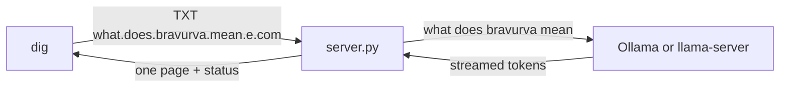

<p align="center">
  
</p>

<p align="center"><b>LLM answers in TXT records, with <code>dig</code> as the client.</b> Backed by Ollama or llama.cpp's <code>llama-server</code>.</p>

<p align="center">
  <a href="https://github.com/Crank-Git/llamaoverdns/actions/workflows/test.yml"></a>
  <a href="https://github.com/Crank-Git/llamaoverdns/releases"></a>
</p>

<p align="center">
  <a href="docs/reference.md"><b>Docs</b></a> ·
  <a href="#install"><b>Install</b></a> ·
  <a href="#quick-start"><b>Quick start</b></a> ·
  <a href="https://github.com/Crank-Git/llamaoverdns/releases"><b>Releases</b></a>
</p>



## Why llamaoverdns

This is a small, fun, intentionally dumb DNS server. You ask a question with `dig`, and
the labels in front of the zone become the prompt for a local model. The answer comes
back in a TXT record. There's no client to install; `dig` is the client.

A model takes longer than `dig` will wait, so generation runs in the background and
streams into a buffer keyed by the prompt. Each query waits up to 3.5 seconds and returns
what's there, plus a status string that tells you what to ask next. Pages chain through
one generation (`p1.`, `p2.`, …) until you see `[done]`, and dig's own retries reattach to
the running generation instead of starting a new one.

## Requirements

- **Python 3.11 or later.** The server and client use only the standard library.
- **An LLM backend:** [Ollama](https://ollama.com) with a model pulled, or llama.cpp's
  `llama-server` with a model loaded.
- **`dig`**, or use the bundled `client.py`.

## Install

Clone it. There's nothing to `pip install`:

```bash
git clone https://github.com/Crank-Git/llamaoverdns.git
cd llamaoverdns
```

## Quick start

With Ollama (`OLLAMA_HOST` is honored; the default is `http://localhost:11434`):

```bash
ollama pull qwen2.5:3b
python3 server.py --backend ollama --model qwen2.5:3b
```

Or with `llama-server`, which listens on `:8080` by default and ignores `--model`:

```bash
llama-server -m path/to/model.gguf --port 8080
python3 server.py --backend llamacpp
```

Then ask it something:

```console
$ dig @127.0.0.1 -p 5300 what.does.bravurva.mean.e.com TXT
;; ANSWER SECTION:
what.does.bravurva.mean.e.com. 0 IN TXT "Bravurva isn't a real word; it's likely a typo or incorrect spelling. It could be meant as 'bravura' which means dramatic display of skill in music. ..." "t more context, no clear meaning. [done]"
```

If the page isn't full yet you'll get `[thinking... repeat the same query]`, which is
normal for the first query of a new prompt. Run the same query again. A full page ends
with `[more: dig p1.<name> TXT]`; run that for the next page.

`client.py` does the paging loop for you and prints the whole answer:

```console
$ python3 client.py --prompt "why is the sky blue"
The sky appears blue due to the Earth's atmosphere scattering sunlight with blue light being scattered more.
```

### Picking a model

Answers have to fit a few 600-byte pages, so a small model that answers directly works
best. Reasoning models are asked not to think (`think: false` for Ollama,
`enable_thinking: false` for `llama-server`), and any `<think>` blocks are stripped
before they reach DNS. Some, like `qwen3`, still reason in plain text with thinking off and
run out of tokens mid-sentence. `qwen2.5` and `llama3.2` give short, clean answers.

## Usage

The labels before the zone are the prompt. The name is lowercased, and a `-` inside a label
is a space:

| Queried name | Prompt |
|---|---|
| `what.does.bravurva.mean.e.com` | `what does bravurva mean` |
| `why-is-the-sky-blue.e.com` | `why is the sky blue` |
| `p1.what.does.bravurva.mean.e.com` | `what does bravurva mean`, page 1 |

The flags you'll reach for first:

| Flag | Default | Meaning |
|---|---|---|
| `--host` | `127.0.0.1` | UDP interface to bind. |
| `--port` | `5300` | UDP port. Use `--port 53` only as root or with `cap_net_bind_service`. |
| `--zone` | `e.com` | Suffix stripped to form the prompt. Names outside it get `REFUSED`. |
| `--backend` | `ollama` | `ollama` or `llamacpp`. |
| `--model` | none | Model name. Required for Ollama. |
| `--wait` | `3.5` | Seconds a query waits for its page. |

Every flag, every status string, and the EDNS0, caching, and resolver notes are in the
[reference](docs/reference.md).

## Documentation

| Page | What's there |
|---|---|
| [Reference](docs/reference.md) | All server and client flags, query mapping, paging and status strings, and limitations. |
| [Architecture](docs/architecture.md) | How `server.py` is layered, from DNS wire format to the backends. |
| [Testing](docs/testing.md) | The unit and end-to-end suites, and how to check against a real model. |

## Development

```bash
python -m unittest -v
```

CI runs this on Python 3.11, 3.12, and 3.13. The end-to-end tests run real `server.py`
processes and the real client over UDP against stub backends, so no model is needed. The
`dig` legs skip if `dig` isn't installed.

## Security

The server has no rate limiting and no authentication. It binds `127.0.0.1` by default;
`--host 0.0.0.0` hands your model to every host that can reach this one, so do that only on
purpose.

---

<sub>Part of <a href="https://github.com/Crank-Git#things-over-port-53"><b>Things over port 53</b></a>,
my experiments in what else DNS can carry.
Siblings: <a href="https://github.com/Crank-Git/epochalypse">epochalypse</a> ·
<a href="https://github.com/Crank-Git/mcport53">mcport53</a> ·
<a href="https://github.com/Crank-Git/wingman">wingman</a> ·
<a href="https://github.com/Crank-Git/cachemoney">cachemoney</a> ·
<a href="https://github.com/Crank-Git/dnscalc">dnscalc</a> ·
Built by <a href="https://github.com/Crank-Git">Crank</a></sub>
